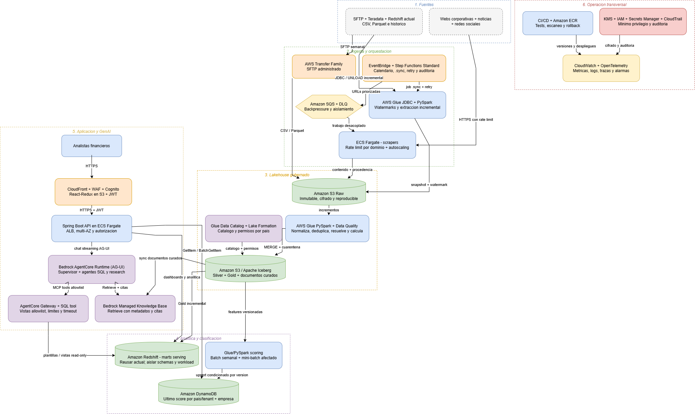

# Plataforma de datos e IA para mscope

Propuesta de arquitectura end-to-end en AWS para integrar informacion corporativa multipais, calcular KPIs y clasificaciones, ofrecer analitica y responder preguntas en lenguaje natural.

## Alcance

- Entre 500.000 y 1.000.000 de empresas totales.
- 10 paises iniciales y unos 100 KPIs por empresa.
- 10 anos de historico y aproximadamente 1 TB nuevo al ano.
- Ingesta semanal desde SFTP, Teradata y Redshift.
- Captura near real-time de webs, noticias y contenido social.
- Aplicacion web para analistas financieros.

## Propuesta

La arquitectura separa tres cargas con necesidades distintas:

1. **Serving operacional:** perfiles y clasificaciones precalculadas en DynamoDB.
2. **Analitica:** historicos, comparaciones y agregaciones en Amazon Redshift.
3. **Lenguaje natural:** recuperacion documental y herramientas analiticas controladas mediante Amazon Bedrock AgentCore.

S3 con Apache Iceberg mantiene el historico reproducible; AWS Glue/PySpark procesa incrementos y aplica calidad; Spring Boot y React-Redux proporcionan la aplicacion.

La fuente editable se encuentra en [`diagrams/arquitectura-general.drawio`](diagrams/arquitectura-general.drawio). Tambien estan disponibles una [version SVG](diagrams/arquitectura-general.drawio.svg) y una [version HTML interactiva](diagrams/arquitectura-general.drawio.html).

## Documentacion

| Apartado | Documento |
|---|---|
| Alcance, requisitos y supuestos | [`docs/01-requisitos-y-alcance.md`](docs/01-requisitos-y-alcance.md) |
| Arquitectura end-to-end | [`docs/02-arquitectura-end-to-end.md`](docs/02-arquitectura-end-to-end.md) |
| Ingesta y orquestacion | [`docs/03-ingesta-y-orquestacion.md`](docs/03-ingesta-y-orquestacion.md) |
| Capa de datos | [`docs/04-capa-de-datos.md`](docs/04-capa-de-datos.md) |
| Analitica y clasificacion | [`docs/05-analitica-y-clasificacion.md`](docs/05-analitica-y-clasificacion.md) |
| Aplicacion y GenAI | [`docs/06-aplicacion-y-genai.md`](docs/06-aplicacion-y-genai.md) |
| Seguridad y red | [`docs/07-seguridad-y-red.md`](docs/07-seguridad-y-red.md) |
| Operacion y resiliencia | [`docs/08-operacion-y-resiliencia.md`](docs/08-operacion-y-resiliencia.md) |
| Dimensionamiento y costes | [`docs/09-dimensionamiento-y-costes.md`](docs/09-dimensionamiento-y-costes.md) |
| Validacion, decisiones y riesgos | [`docs/10-validacion-decisiones-y-riesgos.md`](docs/10-validacion-decisiones-y-riesgos.md) |
| Registro de prompts | [`docs/11-registro-de-prompts.md`](docs/11-registro-de-prompts.md) |

